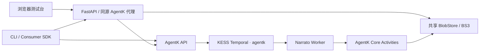

# Narrato AgentK

`narrato-agentk` 是一个独立的 Python 3.13 项目，把 NarratoAI 的纪录片解说流程拆成三个 AgentK Pipeline。它不导入、不修改 NarratoAI；LLM、Qwen TTS、FFmpeg 和 Artifact 存储全部通过 AgentK Core 的稳定 Activity ABI 调用。

## 能力

| Profile Pipeline | Capability | 用途 |
|---|---|---|
| `documentary_video` | `contrib.narrato.create_documentary_video` | 视频分析、脚本、配音与成片 |
| `documentary_script` | `contrib.narrato.generate_documentary_script` | 只生成可编辑 JSON 脚本 |
| `documentary_render` | `contrib.narrato.render_documentary_video` | 根据人工修改后的脚本重新渲染 |

渲染遵循 NarratoAI 的 OST 语义：`0` 配音且移除原声，`1` 不配音并保留原声，`2` 配音且保留原声。自动生成脚本统一使用 `ost=2`。

## 架构



Narrato Worker 只包含确定性的工作流编排和纯函数规则。网络、模型、TTS、探测、裁剪、混音、字幕与合并都在 Core Activity 中执行。Worker 使用 `contrib-narrato-documentary-v1` task queue，Core Activity 默认投递到 `agentk` task queue。

## 本地安装

当前公司内部包源未发布 `agentk-client`、`agentk-protocol` 和 `ks-agentk-worker` 0.1.0，因此项目通过 `pyproject.toml` 引用同级的官方 SDK 源码目录：

```text
Coding/
├── agentk-sdk/
└── narrato-agentk/
```

安装依赖：

```bash
cd /Users/yangshuo/Coding/narrato-agentk
uv sync --extra test
```

复制配置并按公司环境填写：

```bash
cp config.example.yaml config.yaml
export NARRATO_CONFIG="$PWD/config.yaml"
```

环境变量优先于 YAML。主要变量包括 `AGENTK_BASE_URL`、`AGENTK_API_KEY`、`NARRATO_UPLOAD_BUCKET`、`NARRATO_BS3_ENDPOINT`、`NARRATO_CDN_BASE`、`NARRATO_MEDIA_KEY_PREFIX`、三个模型变量以及 `NARRATO_QWEN_VOICE_ID`。Core Activity 默认投递到 `agentk`；隔离本地 E2E 时可通过 `NARRATO_CORE_TASK_QUEUE`（YAML 为 `core_task_queue`）改成唯一队列，但本地 AgentK Core 和 SDK Discovery 队列也必须同步，生产环境不要修改。API 默认只监听 `127.0.0.1`；如果要从其他机器访问，必须同时设置非回环 `NARRATO_API_HOST` 和 `NARRATO_CONSOLE_TOKEN`。

## 启动

先确认 AgentK Core Worker 已启动，并且模型目录包含配置中的三个别名。分别启动上传 API 和贡献 Worker：

```bash
uv run narrato-agentk-api
uv run narrato-agentk-worker
```

API 启动后打开 [http://127.0.0.1:8000](http://127.0.0.1:8000)，即可使用简单交互式测试台。页面支持上传视频、切换三个 Pipeline、预览实际请求 JSON、观察进度事件、查看/保存输出、把生成脚本带入渲染和显式取消远端任务。AgentK API key 只保留在服务端，不会返回浏览器。

Worker 启动前会通过 AgentK API 检查目录中六个可发现 Core Capability 的存在性及关键输入/输出 Schema。任何 ABI 缺失都会阻止三个贡献 Capability 发布。当前 Core 已注册 `agentk.capability.concat_videos` Temporal Activity，但未把它发布进 Consumer Capability Catalog，因此该名称作为固定 Activity ABI 使用，并由离线契约测试校验；这避免为了目录可发现性去修改 `agent-k`。

上传 API：

- `GET /healthz`
- `POST /v1/media`，multipart 字段名为 `file`
- `GET /v1/ui/config`，读取当前模型和 Pipeline 输入 Schema
- `POST /v1/ui/executions`，通过官方 Consumer SDK 启动执行
- `GET /v1/ui/executions/{sessionId}/{executionId}`，轮询事件和输出
- `POST /v1/ui/sessions/{sessionId}/cancel`，显式取消 Session
- 流式落盘并同步计算 SHA-256
- 只接受 MP4、MOV、MKV、WebM，最大 512 MiB
- 对象 key 只使用内容哈希，重复内容直接复用

配置了 `NARRATO_CONSOLE_TOKEN` 后，上传与 `/v1/ui/*` 均要求 `X-Narrato-Console-Token` 请求头；CLI 和浏览器测试台会自动附带该令牌。

## CLI

一条命令从本地视频跑到最终文件：

```bash
uv run narrato-agentk run \
  --file ./input.mp4 \
  --theme "自然纪录片" \
  --voice-id YOUR_QWEN_VOICE_ID \
  --output ./result.mp4
```

分步编辑脚本：

```bash
uv run narrato-agentk script generate \
  --video-uri https://cdn.example/input.mp4 \
  --output script.json

uv run narrato-agentk render \
  --script script.json \
  --voice-id YOUR_QWEN_VOICE_ID \
  --output result.mp4
```

其他命令：

```bash
uv run narrato-agentk upload ./input.mp4
uv run narrato-agentk session create
uv run narrato-agentk watch --session-id SESSION --execution-id EXECUTION
uv run narrato-agentk cancel --session-id SESSION
uv run narrato-agentk download --uri URL --output result.mp4
```

CLI 会持续消费事件；断线后查询执行状态并最多重连三次。`Ctrl-C` 只停止本地观察，不取消远端执行；取消必须显式运行 `cancel`。

## Docker

由于 SDK 是同级本地依赖，使用 BuildKit named context 注入 SDK 源码，同时让主构建上下文只包含本项目：

```bash
cd /Users/yangshuo/Coding/narrato-agentk
docker build --build-context agentk-sdk=../agentk-sdk -t narrato-agentk:latest .
```

默认启动 Worker；上传 API 使用同一镜像覆盖命令：

```bash
docker run --env-file narrato.env narrato-agentk:latest narrato-agentk-worker
docker run --env-file narrato.env \
  -e NARRATO_API_HOST=0.0.0.0 \
  -e NARRATO_CONSOLE_TOKEN="$NARRATO_CONSOLE_TOKEN" \
  -p 8000:8000 \
  narrato-agentk:latest narrato-agentk-api
```

## 验证

```bash
uv run pytest -q
uv run ruff check .
uv run python -m compileall -q src tests
```

离线测试覆盖输入契约、脚本校验、窗口和批次算法、OST 行为、TTS 时长越界、Artifact 缺失、上传限制与去重、CLI 参数。内网 E2E 还需要可访问的 AgentK API、KESS Temporal、Core Worker、模型目录和共享 BlobStore。

逐阶段 Activity 输入输出、异常分类和内网 E2E 候选用例见 [docs/test-cases.md](docs/test-cases.md)。

完整的项目说明、配置与启动命令、当前模型、候选模型，以及逐模块用户可选模型的目标架构见 [docs/PROJECT_GUIDE.md](docs/PROJECT_GUIDE.md)。

## 版权与 MVP 边界

项目采用 MIT License。迁移自 NarratoAI 的 OST/时间轴思想与提示词设计归属见 [NOTICE](NOTICE)。MVP 只包含用于验收的轻量浏览器测试台，不包含生产级账号、任务历史或协作工作台，也不包含多视频、BGM/SFX、ASR、翻译、剪映草稿、声音克隆或高级字幕样式。
