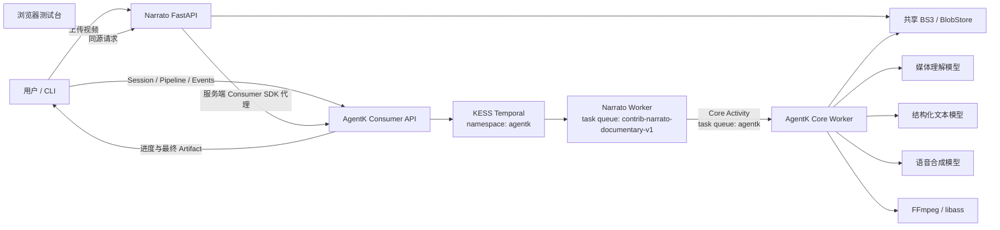
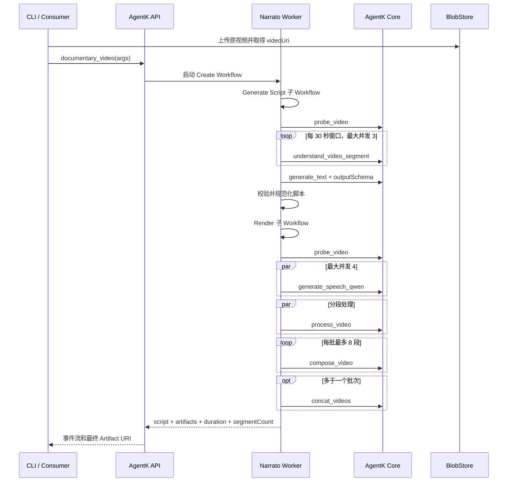
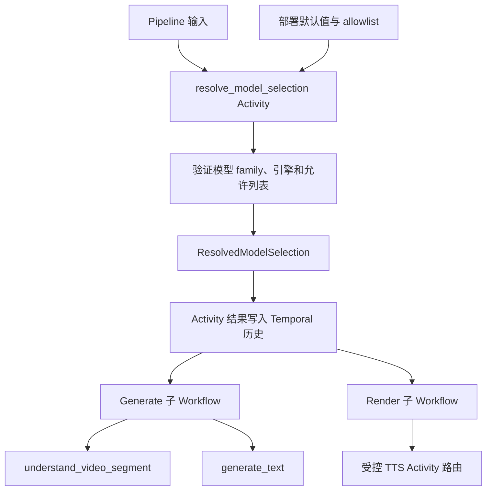

# Narrato AgentK 项目说明、运行手册与模型选择设计

> 文档版本：2026-08-18  
> 对应项目：`narrato-agentk` 0.1.0  
> 当前实现状态：MVP 已完成离线测试；公司内网 AgentK、KESS Temporal、模型与 BS3 E2E 尚待执行。

## 1. 阅读说明

本文同时描述两部分内容：

1. **当前已经实现的能力**：可以直接使用的 Pipeline、配置和命令。
2. **下一版模型选择设计**：让调用者分别选择视频理解、脚本生成和语音合成模型。该部分标记为“目标设计”，当前代码尚未实现这些输入字段和 CLI 参数。浏览器测试台会展示部署实际使用的三个模型，但不会伪装成可选择控件。

不要把目标设计中的 `modelSelection`、`models list`、`--vision-model` 等参数用于当前 0.1.0；它们需要按第 12 节的实施步骤完成后才会生效。

---

## 2. 项目简介

`narrato-agentk` 是一个独立的 Python 3.13 项目。它参考 NarratoAI 的 OST、时间轴、脚本校验和提示词思想，把“单视频纪录片解说”拆成三个 AgentK Pipeline：

| Profile 名称 | Capability ID | 作用 |
|---|---|---|
| `documentary_video` | `contrib.narrato.create_documentary_video` | 从原视频直接生成最终解说成片 |
| `documentary_script` | `contrib.narrato.generate_documentary_script` | 只分析视频并生成可编辑 JSON 脚本 |
| `documentary_render` | `contrib.narrato.render_documentary_video` | 根据脚本生成配音、裁剪、字幕和最终视频 |

项目不在运行时导入 NarratoAI，也不修改 `NarratoAI`、`agent-k` 或 `agentk-sdk`。模型调用、TTS、FFmpeg 和产物存储继续由 AgentK Core 提供；本项目只负责业务契约、Workflow 编排、上传 API、CLI 和本地纯函数规则。

### 2.1 目标场景

- 输入一个 MP4、MOV、MKV 或 WebM 视频。
- 自动分析画面并生成中文纪录片解说脚本。
- 支持导出脚本、人工修改 OST 和文案后重新渲染。
- 通过 AgentK 事件流查看进度、终态和产物 URI。
- 通过轻量浏览器测试台查看每个 Pipeline 的实际输入与输出。
- 最终得到 H.264/AAC MP4，并按需烧录字幕。

### 2.2 MVP 不包含

- 多视频素材编排。
- 生产级账号、任务历史、协作式 Web/Streamlit 工作台（当前仅提供验收测试台）。
- BGM、SFX、ASR、翻译与字幕纠错。
- 剪映草稿。
- 声音克隆工作流和高级字幕样式。
- 将 Pipeline 作为 Agent 自主选择的 Tool。

---

## 3. 整体架构



### 3.1 职责边界

| 组件 | 负责内容 | 不负责内容 |
|---|---|---|
| Narrato Worker | Workflow、顺序、并发、OST、时间轴、错误分类 | 模型 Provider、FFmpeg 实现、媒体存储实现 |
| AgentK Core Worker | 视频探测、媒体理解、文本生成、TTS、裁剪、合成、拼接 | Narrato 业务规则 |
| FastAPI | 单视频流式上传、轻量前端、同源 Consumer SDK 代理 | 长期任务持久化或模型执行 |
| CLI | 上传、创建 Session、启动 Pipeline、观察事件、导出和下载 | 长期任务持久化 |
| Temporal | 执行历史、重试、恢复、取消和 Workflow 状态 | 直接执行网络或 FFmpeg 操作 |

### 3.2 核心 Activity ABI

当前 Workflow 直接调用：

```text
agentk.capability.probe_video
agentk.capability.understand_video_segment
agentk.capability.generate_text
agentk.capability.generate_speech_qwen
agentk.capability.process_video
agentk.capability.compose_video
agentk.capability.concat_videos
```

所有 Activity 默认投递到 Core task queue `agentk`。隔离本地 E2E 可设置 `NARRATO_CORE_TASK_QUEUE`，但 AgentK Core 和 SDK Discovery 必须使用相同队列。

---

## 4. 目录结构

```text
narrato-agentk/
├── pyproject.toml                 # Python 包、依赖、命令入口、质量工具
├── uv.lock                        # 锁定依赖
├── config.example.yaml            # 示例配置，不应写真实凭证
├── Dockerfile                     # API 与 Worker 共用镜像
├── README.md                      # 快速入口
├── LICENSE / NOTICE               # MIT 与 NarratoAI 归属说明
├── docs/
│   ├── PROJECT_GUIDE.md           # 本文
│   └── test-cases.md              # 逐阶段 I/O 与候选测试用例
├── src/narrato_agentk/
│   ├── agentk_client.py           # AgentK Consumer SDK 客户端适配
│   ├── settings.py                # YAML 与环境变量配置
│   ├── worker.py                  # 三个 Capability 的发布入口
│   ├── agentk_core/abi.py         # Core Activity 名称和返回值辅助函数
│   ├── contracts/
│   │   ├── models.py              # 输入与脚本规范化
│   │   ├── schemas.py             # Pipeline JSON Schema
│   │   └── timeline.py            # OST、裁剪、批次和相对时间轴
│   ├── workflows/documentary.py   # 三个 Temporal Workflow
│   ├── prompts/documentary.py     # 视频分析和脚本生成提示词
│   ├── media/store.py             # BS3 上传、哈希和去重
│   ├── api/main.py                # FastAPI 入口
│   ├── ui/service.py               # 浏览器到 Consumer SDK 的服务端适配
│   ├── ui/static/                  # 零构建 HTML/CSS/JavaScript 测试台
│   └── cli/main.py                # Consumer CLI
└── tests/                         # 契约、Workflow、上传、CLI 和 Worker 测试
```

---

## 5. 业务流程与逐阶段输入输出

### 5.1 一键成片流程



### 5.2 脚本生成阶段

| 步骤 | 输入 | 输出 | 本地强制规则 |
|---|---|---|---|
| Pipeline 校验 | `videoUri/theme/instructions` | 规范化参数 | URI 必须为绝对 HTTP(S) URL |
| `probe_video` | `{videoUrl}` | 文件大小、时长、视频流 | 1–512 MiB、时长大于 0、必须有视频流 |
| 窗口切分 | 视频时长、默认 30 秒 | 原始时间窗口 | 尾窗口按真实时长截断 |
| `understand_video_segment` | 模型、URI、起止时间、提示词 | `{text}` | 不采信模型自行生成的时间戳 |
| `generate_text` | 文本模型、总提示词、JSON Schema | `{result}` | 输出必须符合脚本 Schema |
| 脚本规范化 | 模型脚本 | 最终脚本 | 重排 ID、源 URI/时长取可信值、自动 OST 强制为 2 |

脚本示例：

```json
{
  "version": "1",
  "sourceVideoUri": "https://cdn.example/source.mp4",
  "sourceDurationSeconds": 60.0,
  "theme": "自然纪录片",
  "segments": [
    {
      "id": "segment-001",
      "sourceStartSeconds": 0.0,
      "sourceEndSeconds": 10.0,
      "narration": "晨雾沿着山谷缓慢散开。",
      "ost": 2
    }
  ]
}
```

### 5.3 渲染阶段与 OST

| OST | 是否 TTS | 实际裁剪长度 | 原声 | 字幕 |
|---:|---|---|---|---|
| 0 | 是 | TTS 的 `metadata.audioLengthMs`；缺失时探测受管音频 Artifact | `mute`，移除 | 有 |
| 1 | 否 | `sourceEndSeconds - sourceStartSeconds` | 保留 | 无配音字幕 |
| 2 | 是 | TTS 的 `metadata.audioLengthMs`；缺失时探测受管音频 Artifact | 保留并与配音混合 | 有 |

渲染阶段必须再次 `probe_video`。如果人工脚本中的源时长与当前视频相差超过 0.5 秒，任务失败；如果 `sourceStart + TTS 时长` 超出原视频，任务明确失败，不静默截断。

每最多 8 段进入一个 `compose_video` 批次。批次内部重新从 0 计算配音与字幕时间轴；多个批次最后用 `concat_videos` 合并。

### 5.4 最终输出

```json
{
  "script": {
    "version": "1",
    "sourceVideoUri": "https://cdn.example/source.mp4",
    "sourceDurationSeconds": 60.0,
    "theme": "自然纪录片",
    "segments": [
      {
        "id": "segment-001",
        "sourceStartSeconds": 0.0,
        "sourceEndSeconds": 10.0,
        "narration": "晨雾沿着山谷缓慢散开。",
        "ost": 2
      }
    ]
  },
  "artifacts": [
    {
      "type": "video",
      "uri": "https://cdn.example/final.mp4",
      "description": "纪录片解说成片"
    }
  ],
  "durationSeconds": 8.4,
  "segmentCount": 1
}
```

---

## 6. 环境要求

### 6.1 本地代码布局

当前 AgentK Python 包尚未从公司内部包源独立发布，因此开发环境要求同级存在官方 SDK 源码：

```text
/Users/yangshuo/Coding/
├── agent-k/          # AgentK Core，仅用于部署和核对能力
├── agentk-sdk/       # Python SDK 本地依赖
└── narrato-agentk/   # 本项目
```

### 6.2 软件与服务

- Python 3.13。
- `uv`。
- 公司内网和 KESS 环境。
- AgentK Consumer API 可访问。
- KESS 服务 `klingai-muse-temporal-server` 可发现。
- Temporal namespace 固定为 `agentk`。
- AgentK Core Worker 正在监听 task queue `agentk`。
- Core Worker 使用兼容的 BlobStore bucket。
- FFmpeg 支持 H.264/AAC 和 `libass/subtitles` filter。
- AgentK model catalog 已配置需要的视觉、文本和 TTS 模型。

### 6.3 端口

| 服务 | 默认地址 |
|---|---|
| Narrato API 与浏览器测试台 | 默认 `127.0.0.1:8000` |
| AgentK API | 由 `AGENTK_BASE_URL` 指定 |
| Temporal | 由 KESS 自动发现，不在项目中手工填写地址 |

---

## 7. 配置

复制示例：

```bash
cd /Users/yangshuo/Coding/narrato-agentk
cp config.example.yaml config.yaml
export NARRATO_CONFIG="$PWD/config.yaml"
```

配置示例：

```yaml
agentk:
  base_url: "https://agentk.internal"
  api_key: "从安全凭证系统注入，不要提交到 Git"

# 仅本机访问可留空；跨主机访问浏览器测试台时必须设置
console_token: ""
api_host: "127.0.0.1"

media:
  api_url: "http://127.0.0.1:8000"
  upload_bucket: "与 AgentK Core 兼容的 bucket"
  bs3_endpoint: "https://bs3.internal"
  cdn_base: "https://cdn.internal/bucket"
  key_prefix: "narrato-agentk"

models:
  vision: "gemini-3.1-flash-lite"
  text: "deepseek-v4-pro"
  tts: "qwen3-tts-flash"

qwen_voice_id: "账号中已配置的 Qwen 音色 ID"
analysis_window_seconds: 30
analysis_concurrency: 3
tts_concurrency: 4
worker_task_queue: "contrib-narrato-documentary-v1"
```

### 7.1 环境变量

环境变量优先于 YAML 中对应字段。

| 环境变量 | 用途 | 当前默认值/要求 |
|---|---|---|
| `NARRATO_CONFIG` | YAML 文件路径 | 可选 |
| `AGENTK_BASE_URL` | AgentK Consumer API | `https://agentk.internal` |
| `AGENTK_API_KEY` | AgentK 鉴权 | Worker/CLI 必填 |
| `NARRATO_CONSOLE_TOKEN` | 浏览器到同源 AgentK 代理的访问令牌 | 本机可空；远程必填 |
| `NARRATO_API_HOST` | API 监听地址 | `127.0.0.1`；非回环地址要求令牌 |
| `NARRATO_MEDIA_API_URL` | CLI 上传目标 | `http://127.0.0.1:8000` |
| `NARRATO_UPLOAD_BUCKET` | 上传 bucket | API 必填 |
| `NARRATO_BS3_ENDPOINT` | BS3 HTTP endpoint | API 必填 |
| `NARRATO_CDN_BASE` | 返回给 AgentK 的访问前缀 | API 必填 |
| `NARRATO_MEDIA_KEY_PREFIX` | Blob key 前缀 | `narrato-agentk` |
| `NARRATO_VISION_MODEL` | 当前固定视觉模型 | `gemini-3.1-flash-lite` |
| `NARRATO_TEXT_MODEL` | 当前固定脚本模型 | `deepseek-v4-pro` |
| `NARRATO_TTS_MODEL` | 当前固定 Qwen TTS 模型 | `qwen3-tts-flash` |
| `NARRATO_QWEN_VOICE_ID` | CLI 默认音色 | 无 |

`analysis_window_seconds`、两个并发数和 `worker_task_queue` 当前通过 YAML 配置，不提供对应环境变量覆盖。

---

## 8. 启动与使用命令

### 8.1 安装依赖

```bash
cd /Users/yangshuo/Coding/narrato-agentk
uv sync --extra test
```

### 8.2 启动上传 API

新开一个终端：

```bash
cd /Users/yangshuo/Coding/narrato-agentk
export NARRATO_CONFIG="$PWD/config.yaml"
uv run narrato-agentk-api
```

检查：

```bash
curl --fail --silent http://127.0.0.1:8000/healthz
```

预期：

```json
{"status":"ok"}
```

同一个进程也提供浏览器测试台。使用本机浏览器打开：

```text
http://127.0.0.1:8000
```

页面交互顺序：

1. 选择“一键成片”“生成脚本”或“脚本渲染”。
2. 上传本地视频，或直接填写 AgentK 可访问的 `videoUri`。
3. 填入对应参数；右侧“请求 JSON”会实时显示即将提交的精确结构。
4. 点击“启动 Pipeline”，页面会自动创建或复用 Session，并每 1.5 秒恢复事件。
5. 在“事件”和“输出 JSON”中检查阶段、百分比、片段计数和最终结果。
6. 生成脚本后可点击“使用此脚本渲染”；成片完成后可直接打开 Artifact URI。

测试台的 AgentK 调用由 FastAPI 服务端使用官方 Consumer SDK 完成，`AGENTK_API_KEY` 不会下发到浏览器。本机回环地址默认允许访问；从其他机器或容器暴露页面时，必须在服务端设置：

```bash
export NARRATO_API_HOST=0.0.0.0
export NARRATO_CONSOLE_TOKEN='使用密码管理器生成的随机长令牌'
uv run narrato-agentk-api
```

然后在页面的“高级：Session 与远程访问”区域填写同一个 Console Token。令牌只保存在当前标签页的 `sessionStorage`，并同时用于上传和 `/v1/ui/*` 请求。CLI 从同一个配置读取令牌并自动附加请求头。API 拒绝在没有令牌时监听非回环地址，并为页面设置 CSP、禁止 iframe 嵌入等安全响应头。测试台仍不是生产级多用户控制面，生产暴露时还应由 TLS 内网网关保护。

### 8.3 启动 Narrato Worker

再开一个终端：

```bash
cd /Users/yangshuo/Coding/narrato-agentk
export NARRATO_CONFIG="$PWD/config.yaml"
uv run narrato-agentk-worker
```

Worker 会先检查可发现的 Core Capability，再连接 KESS Temporal 并发布三个 Narrato Capability。Worker 进程需要持续运行。

### 8.4 上传视频

```bash
uv run narrato-agentk upload ./input.mp4
```

输出是可交给 Pipeline 的 URI。也可直接调用 API：

```bash
curl --fail \
  -F 'file=@./input.mp4;type=video/mp4' \
  http://127.0.0.1:8000/v1/media
```

### 8.5 一条命令生成最终视频

```bash
uv run narrato-agentk run \
  --file ./input.mp4 \
  --theme "自然纪录片" \
  --instructions "语气克制，只描述画面可确认的事实" \
  --voice-id YOUR_QWEN_VOICE_ID \
  --aspect 16:9 \
  --narration-volume 0.9 \
  --output ./result.mp4
```

使用已有视频 URI：

```bash
uv run narrato-agentk run \
  --video-uri 'https://cdn.example/source.mp4' \
  --voice-id YOUR_QWEN_VOICE_ID \
  --output ./result.mp4
```

关闭字幕：

```bash
uv run narrato-agentk run \
  --file ./input.mp4 \
  --voice-id YOUR_QWEN_VOICE_ID \
  --no-subtitles \
  --output ./result.mp4
```

### 8.6 分步生成、编辑和渲染

生成脚本：

```bash
uv run narrato-agentk script generate \
  --video-uri 'https://cdn.example/source.mp4' \
  --theme "城市纪录片" \
  --output ./script.json
```

人工编辑 `script.json` 后渲染：

```bash
uv run narrato-agentk render \
  --script ./script.json \
  --voice-id YOUR_QWEN_VOICE_ID \
  --aspect 9:16 \
  --output ./result.mp4
```

### 8.7 Session、观察、取消和下载

```bash
uv run narrato-agentk session create --title "纪录片任务"

uv run narrato-agentk watch \
  --session-id SESSION_ID \
  --execution-id EXECUTION_ID

uv run narrato-agentk cancel --session-id SESSION_ID

uv run narrato-agentk download \
  --uri 'https://cdn.example/final.mp4' \
  --output ./result.mp4
```

`Ctrl-C` 只停止本地观察，不取消远端任务；取消必须显式运行 `cancel`。

### 8.8 Docker

构建时通过 BuildKit named context 注入同级 SDK：

```bash
cd /Users/yangshuo/Coding/narrato-agentk
docker build \
  --build-context agentk-sdk=../agentk-sdk \
  -t narrato-agentk:latest .
```

启动 API：

```bash
docker run --rm \
  -p 8000:8000 \
  -v "$PWD/config.yaml:/etc/narrato/config.yaml:ro" \
  -e NARRATO_CONFIG=/etc/narrato/config.yaml \
  -e NARRATO_API_HOST=0.0.0.0 \
  -e NARRATO_CONSOLE_TOKEN="$NARRATO_CONSOLE_TOKEN" \
  narrato-agentk:latest narrato-agentk-api
```

启动 Worker：

```bash
docker run --rm \
  -v "$PWD/config.yaml:/etc/narrato/config.yaml:ro" \
  -e NARRATO_CONFIG=/etc/narrato/config.yaml \
  narrato-agentk:latest narrato-agentk-worker
```

生产环境不应把真实 API key 固定写入镜像或提交到配置文件，应由 KESS/容器密钥系统在运行时注入。

---

## 9. 当前使用的模型

当前 0.1.0 的模型由 Worker 部署配置固定，普通 Pipeline 调用者不能覆盖。

| 模块 | 当前默认模型 | Core Activity | 输入作用 | 输出作用 |
|---|---|---|---|---|
| 视频分段理解 | `gemini-3.1-flash-lite` | `understand_video_segment` | 视频 URI、30 秒窗口、分析提示词 | 中文画面事实记录 |
| 结构化脚本生成 | `deepseek-v4-pro` | `generate_text` | 全部窗口分析、主题、要求、JSON Schema | 结构化纪录片脚本 |
| 语音合成 | `qwen3-tts-flash` | `generate_speech_qwen` | narration、voiceId、Chinese | 音频 Artifact 与真实时长 |

### 9.1 `gemini-3.1-flash-lite`

- AgentK 当前对 `understand_video_segment` 的默认绑定。
- 适合大量固定长度窗口的并发理解任务。
- 本项目只采用 Activity 请求中指定的原始时间窗口，不信任模型自行声称的时间。
- 如果画面复杂、镜头变化快或需要更细节的观察，可在候选中评估 Flash 或 Pro。

### 9.2 `deepseek-v4-pro`

- 当前脚本生成默认值。
- `generate_text` 会附加严格 JSON Schema，并在 Core 中校验模型输出。
- 本地还会校验时间范围、ID、OST、源 URI 和时长，因此模型不能覆盖可信媒体元数据。
- 模型的选择主要影响文案质量、中文表达、结构化输出稳定性、延迟和成本。

### 9.3 `qwen3-tts-flash`

- 当前 Qwen TTS Activity 唯一允许的静态模型。
- 需要账号下已经配置的 `voiceId`。
- Workflow 优先使用返回的 `metadata.audioLengthMs`；当前 Qwen Core 输出缺失该字段时，对返回的受管音频 Artifact 再调用 Core `probe_video`/ffprobe 获得真实时长，绝不按文本长度猜测渲染时长。
- 当前请求固定 `languageType=Chinese`。

---

## 10. 可选模型候选

> 以下候选来自本机当前 `agent-k/models.yaml` 和 Core Capability Schema 的 2026-08-18 快照。不同环境的 model catalog 可能不同；“目录中存在”不等于部署凭证、配额和服务一定可用，上线前必须做真实调用验证。

### 10.1 视频理解候选

Core Schema 当前允许三个模型：

| 模型 | 建议定位 | 使用建议 |
|---|---|---|
| `gemini-3.1-flash-lite` | 默认、吞吐优先 | 大多数纪录片和批量窗口分析 |
| `gemini-3-flash-preview` | 质量与速度平衡候选 | 先用代表性视频做准确率和延迟对比 |
| `gemini-3.1-pro-preview` | 复杂画面和细节优先候选 | 需要更强效果且可接受更高延迟时评估 |

这三个名称是 `understand_video_segment` 的合法枚举；其他具备视觉能力的 Chat 模型并不自动等于媒体理解 Activity 可用模型。

### 10.2 结构化文本候选

`generate_text` 会按 model catalog entry name 查找 Chat client。当前目录中可评估：

| 模型 | 工程定位建议 | 验证重点 |
|---|---|---|
| `deepseek-v4-pro` | 当前默认，质量优先 | JSON 合法率、中文连贯性、事实约束 |
| `deepseek-v4-flash` | 延迟/吞吐候选 | 与 Pro 的脚本质量差异 |
| `gpt-5.4` | 高质量结构化输出候选 | 可用性、延迟、成本与中文风格 |
| `claude-sonnet-4-6` | 长文与叙事候选 | JSON 稳定性和文案节奏 |
| `claude-haiku-4-5` | 低延迟候选 | 复杂脚本的细节损失 |
| `glm-5.1` | 中文模型候选 | 中文表达、结构化遵循率 |
| `kimi-k2.6` | 长上下文候选 | 多窗口信息整合能力 |
| `qwen3.7-max` | 中文综合质量候选 | 文案自然度和时间区间遵循 |
| `qwen3.5-plus` | 当前目录中的独立链路候选 | 网络可用性和结构化结果 |

表中的定位是本项目选型建议，不是对厂商规格的承诺。最终选择必须用同一组视频、同一提示词和同一 Schema 做基准测试。

### 10.3 TTS 候选

#### 当前可直接替换

当前 Workflow 固定调用 `generate_speech_qwen`，该 Activity Schema 只允许：

```text
qwen3-tts-flash
```

因此在不改 Activity 的前提下，没有第二个 TTS 模型可选。

#### 需要切换 TTS Activity 的扩展候选

| 引擎 | 模型或部署别名 | 当前本机目录状态 | Core Activity | 额外契约 |
|---|---|---|---|---|
| Qwen | `qwen3-tts-flash` | 已配置 | `generate_speech_qwen` | `voiceId`、languageType、可选演绎指令 |
| MiniMax | `minimax-speech-2.8-hd` | 已配置 | `generate_speech_minimax` | `voiceId`、speed、languageBoost、emotion |
| CosyVoice | `cosyvoice-v3.5-plus` | Core 支持，但当前目录条目仍被注释，需先配置音色和凭证 | `generate_speech_cosyvoice` | `voiceId`、可选 instructions |
| IndexTTS | 部署别名，例如 `indextts-maas-prod` | 已配置该示例别名 | `generate_speech_indextts` | `speakerAudioUrl`，可选情绪控制 |

四类 TTS 的输出都采用 `artifacts + metadata` envelope，并可返回 `audioLengthMs`，所以渲染时间轴可以复用；但输入契约和音色来源不同，不能只替换模型字符串。

---

## 11. 用户可选模型的目标设计

### 11.1 需求

- 用户可以分别选择视频理解、脚本生成和语音合成模型。
- 不选择时使用部署管理员设置的默认值。
- 用户只能选择部署允许且类型匹配的模型，不能传任意 Provider 名称或 Activity 名称。
- 最终解析出的模型必须写入 Temporal 历史，Worker 重启或重放时不能漂移。
- 一键 Workflow 的生成与渲染子 Workflow 必须使用同一份已解析配置。
- 结果中应记录实际使用的模型，便于复现、审计和效果对比。
- 旧调用不传 `modelSelection` 时继续工作。

### 11.2 方案比较

| 方案 | 优点 | 缺点 | 结论 |
|---|---|---|---|
| 只使用环境变量 | 最简单 | 每次任务不能选；当前模块全局配置还会被 Temporal sandbox 丢失 | 不采用 |
| Pipeline 接受任意模型字符串 | 灵活 | 可能越权调用高成本模型；容易传错模型 family；难以生成下拉候选 | 不采用 |
| Pipeline 接受受控 `modelSelection`，由部署 allowlist 校验 | 用户可选、可审计、可限制成本、可生成 UI/CLI 候选 | 需要新增解析 Activity 和动态 Schema | **推荐** |

### 11.3 Pipeline 输入

推荐新增可选字段：

```json
{
  "modelSelection": {
    "videoUnderstanding": "gemini-3.1-flash-lite",
    "scriptGeneration": "deepseek-v4-pro",
    "speechSynthesis": {
      "engine": "qwen",
      "model": "qwen3-tts-flash"
    }
  }
}
```

三个 Pipeline 使用范围：

| Pipeline | 可接受字段 |
|---|---|
| `documentary_script` | `videoUnderstanding`、`scriptGeneration` |
| `documentary_render` | `speechSynthesis` |
| `documentary_video` | 三者全部 |

字段缺失时采用部署默认值；未知字段、未知模型、模型 family 不匹配或模型未在 allowlist 中时，任务在调用 Core 前以 `InvalidArgument` 失败。

### 11.4 TTS 引擎参数

为兼容不同 TTS，不建议继续把所有参数都堆在 Pipeline 顶层。目标结构：

```json
{
  "speech": {
    "engine": "qwen",
    "model": "qwen3-tts-flash",
    "voiceId": "Cherry",
    "options": {
      "languageType": "Chinese",
      "instructions": "沉稳、克制的纪录片旁白"
    }
  }
}
```

IndexTTS 示例：

```json
{
  "speech": {
    "engine": "indextts",
    "model": "indextts-maas-prod",
    "speakerAudioUri": "https://cdn.example/reference.wav",
    "options": {
      "emotionControlMethod": "text",
      "emotionText": "沉静而有探索感"
    }
  }
}
```

第一阶段只开放 Qwen，可以保留现有顶层 `voiceId` 兼容字段；第二阶段再引入统一 `speech` 对象，并在一个主版本周期后弃用顶层 `voiceId`。

### 11.5 部署端默认值与 allowlist

目标配置：

```yaml
model_policy:
  defaults:
    video_understanding: gemini-3.1-flash-lite
    script_generation: deepseek-v4-pro
    speech:
      engine: qwen
      model: qwen3-tts-flash

  allowed:
    video_understanding:
      - gemini-3.1-flash-lite
      - gemini-3-flash-preview
      - gemini-3.1-pro-preview
    script_generation:
      - deepseek-v4-pro
      - deepseek-v4-flash
      - glm-5.1
      - qwen3.7-max
    speech:
      qwen:
        - qwen3-tts-flash
```

管理员可以只开放经过成本、稳定性和合规验证的子集。配置中只存 model catalog entry name，不存 Provider endpoint 或凭证。

### 11.6 解析流程与 Temporal 确定性



必须新增一个本项目自己的轻量配置 Activity，例如：

```text
contrib.narrato.resolve_model_selection
```

它只读取部署配置、合并用户选择并返回纯 JSON，不调用模型。Activity 的返回值会被 Temporal 记录，因此配置文件在任务运行中或 Worker 重启后发生变化，也不会改变已经解析完成的执行。

不要继续在 Workflow 中读取模块全局 `_SETTINGS`。一键 Workflow 应先解析一次，然后把完整的 `resolvedModelSelection` 传给两个子 Workflow；子 Workflow 不再独立读取环境配置。

### 11.7 解析后的结构

```json
{
  "videoUnderstanding": {
    "model": "gemini-3.1-flash-lite"
  },
  "scriptGeneration": {
    "model": "deepseek-v4-pro"
  },
  "speechSynthesis": {
    "engine": "qwen",
    "activity": "agentk.capability.generate_speech_qwen",
    "model": "qwen3-tts-flash"
  }
}
```

`activity` 由 Worker 根据受控 `engine` 映射，不允许用户直接提交。

### 11.8 输出与审计

建议在三个 Pipeline 输出中增加：

```json
{
  "resolvedModels": {
    "videoUnderstanding": "gemini-3.1-flash-lite",
    "scriptGeneration": "deepseek-v4-pro",
    "speechSynthesis": {
      "engine": "qwen",
      "model": "qwen3-tts-flash"
    }
  }
}
```

模型名称可以写入结果和简短进度事件；Provider endpoint、API key、完整提示词和模型原始响应不得写入事件。

### 11.9 Capability Schema 与候选发现

Worker 启动时应根据 `model_policy.allowed` 构造 Pipeline input schema 中的 `enum`，然后发布 Capability。这样：

- AgentK Consumer 可以通过 `ListCapabilities` 读取候选。
- CLI 可以实现 `narrato-agentk models list`。
- 未来 UI 可以直接渲染三个下拉框。
- 候选与 Worker 实际 allowlist 保持一致。

对于文本模型，还应在发布前验证 allowlist 中的名字确实存在于当前 AgentK model catalog。当前 Consumer API 没有独立 `ListModels` RPC，因此需要 AgentK 增加只读模型目录接口，或由部署流水线对 model catalog 做契约检查；在此之前，首次 Core 调用仍是最终可用性校验。

### 11.10 目标 CLI

目标命令示例，当前 0.1.0 尚不可用：

```bash
narrato-agentk models list

narrato-agentk run \
  --file ./input.mp4 \
  --vision-model gemini-3-flash-preview \
  --text-model deepseek-v4-pro \
  --tts-engine qwen \
  --tts-model qwen3-tts-flash \
  --voice-id Cherry \
  --output ./result.mp4

narrato-agentk script generate \
  --video-uri 'https://cdn.example/source.mp4' \
  --vision-model gemini-3.1-pro-preview \
  --text-model qwen3.7-max \
  --output ./script.json

narrato-agentk render \
  --script ./script.json \
  --tts-engine minimax \
  --tts-model minimax-speech-2.8-hd \
  --voice-id VOICE_ID \
  --output ./result.mp4
```

CLI 参数只负责构造 Pipeline 输入，最终校验始终在服务端完成，不能把 CLI 校验当作安全边界。

---

## 12. 模型选择功能的实施顺序

1. 修复 Workflow 模块全局配置问题，引入可记录历史的配置解析 Activity。
2. 定义 `ModelSelectionInput`、`ResolvedModelSelection` 和 JSON Schema。
3. 在 YAML 中增加默认模型与 allowlist，并验证默认值一定属于 allowlist。
4. 为三个 Pipeline Schema 增加可选 `modelSelection`。
5. 一键 Workflow 解析一次模型选择，并传给两个子 Workflow。
6. 视觉与文本 Activity payload 改用解析后的模型，不读取 `_SETTINGS`。
7. 第一阶段保留 Qwen TTS，只开放 `engine=qwen`。
8. 在输出中增加 `resolvedModels`，并保证旧输入继续可用。
9. 动态生成 Capability Schema enum，实现 CLI `models list`。
10. 第二阶段增加 MiniMax、CosyVoice、IndexTTS 路由和各自参数 Schema。

### 12.1 必需测试

| 类型 | 用例 |
|---|---|
| 默认值 | 不传 `modelSelection` 时使用部署默认值 |
| 单模块覆盖 | 只覆盖 vision/text/tts 之一，其他保持默认 |
| allowlist | 目录存在但未授权的模型仍被拒绝 |
| family | Chat 模型不能用于视频理解，视觉模型不能用于 Qwen TTS |
| 引擎路由 | `engine=qwen/minimax/cosyvoice/indextts` 映射到正确 Activity |
| 子 Workflow | 一键任务把同一份已解析结果传给生成和渲染 |
| 重放 | 配置文件改变后重放旧历史，Activity 命令和模型不漂移 |
| Worker 重启 | 运行中的任务继续使用历史中已解析的模型 |
| 输出审计 | `resolvedModels` 与实际 Activity payload 一致 |
| CLI | 参数被准确序列化，服务端拒绝伪造 Activity 名称 |
| TTS I/O | 每个引擎必须返回 `type=audio` Artifact；`audioLengthMs` 缺失时 Artifact 必须能被 Core 探测出正数时长 |

---

## 13. 进度、错误和恢复

### 13.1 进度阶段

```text
validate_input       5%
analyze_video       10–35%
generate_script     40%
synthesize_speech   45–60%
cut_segments        60–75%
compose_batches     75–95%
finalize             98%
complete            100%
```

分段事件可以包含 `completed`、`total` 和 `segmentId`，但不得包含凭证、完整提示词或大段模型原始响应。

### 13.2 错误分类

| 错误 | 处理 |
|---|---|
| 输入字段、OST、时间轴、模型选择非法 | `InvalidArgument`，不可重试 |
| 模型未配置或 family 不匹配 | 配置错误，发布期或执行早期失败 |
| 模型限流、超时、5xx | 按 Activity RetryPolicy 重试 |
| 模型脚本不符合 Schema | 本地再生成一次，仍错误则终止 |
| TTS 缺少音频 Artifact，或 metadata 与 Artifact 探测都无法得到真实时长 | 终止，不猜测 |
| FFmpeg 或媒体损坏 | 采用 Core Activity 分类和重试策略 |
| 用户取消 | AgentK 终态必须为 `CANCELLED` |

### 13.3 断线恢复

CLI 的目标行为：

1. 持续消费 `watch_events`。
2. 断线后通过 `list_events` 补齐事件并按 event ID 去重。
3. 查询 `get_execution` 判断真实终态。
4. 只有 `COMPLETED` 且输出合法时退出 0。
5. `FAILED`、`CANCELLED` 或完成但无输出时返回非零状态。

---

## 14. 测试命令

```bash
cd /Users/yangshuo/Coding/narrato-agentk

uv run pytest -q
uv run ruff check .
uv run ruff format --check .
uv run python -m compileall -q src tests
uv build
```

当前离线基线为 71 个测试通过。完整验收还需要：

```text
1. 启动 AgentK API、Core Worker 和 Narrato Worker。
2. 上传 10 秒与 65 秒样片。
3. 分别运行脚本、渲染和一键 Pipeline。
4. 验证事件、取消、Worker 重启恢复。
5. 下载最终 MP4。
6. 用 ffprobe 验证容器、H.264、AAC、时长、画幅和音轨。
7. 抽帧确认字幕烧录。
8. 对每个开放模型运行同一组基准视频。
```

---

## 15. 上线前必须处理的问题

当前代码可以继续用于本地和受控环境验证，但生产共享环境上线前至少应完成：

1. **修复 Temporal sandbox 配置问题**：不能依赖 Workflow 模块全局 `_SETTINGS`。
2. **修复 CLI 终态处理**：FAILED/CANCELLED 不能退出 0。
3. **保护上传 API**：增加鉴权、并发限制和配额，或强制认证网关。
4. **调整 Activity 总超时**：保证第二次尝试拥有完整执行时间。
5. **限制输入规模**：视频时长/窗口数、提示词字段长度、脚本总字节数。
6. **验证真实媒体格式**：不能只相信 multipart MIME 和后缀。
7. **加强启动契约检查**：模型、`concat_videos`、嵌套 Schema 和共享存储。
8. **验证 Artifact 类型**：TTS 必须是 audio，视频阶段必须是 video。
9. **原子下载**：失败不能在目标路径留下残缺文件。
10. **完成内网 E2E**：包括模型候选、取消和 Temporal 重放。

---

## 16. 架构决策记录：受控的逐任务模型选择

### 状态

Proposed，等待模型选择功能实施时采用。

### 背景

当前模型由部署配置固定，无法按任务比较效果；同时 Workflow 使用模块全局配置，与 Temporal sandbox 和重放要求不兼容。直接允许任意模型字符串又会造成模型 family 错配、成本越权和不可发现的运行时失败。

### 决策

- Pipeline 增加可选、结构化的 `modelSelection`。
- 部署端维护默认值和 allowlist。
- 使用本地配置解析 Activity 合并并验证选择，将结果固化进 Temporal 历史。
- 一键 Workflow 只解析一次并传递给子 Workflow。
- TTS 使用受控 `engine -> Activity` 映射，不接受调用者直接指定 Activity 名称。
- Capability Schema 公布部署允许的候选，CLI/UI 从 Schema 生成选择项。
- 最终输出记录 `resolvedModels`。

### 正面影响

- 每个任务可以独立做模型 A/B 测试。
- 旧调用仍可使用部署默认值。
- 管理员可以限制昂贵或未验证模型。
- 执行可复现，Worker 重启后模型不漂移。
- CLI、UI 与服务端使用同一候选来源。

### 代价

- 需要一个轻量配置 Activity 和更多契约测试。
- 动态 Capability Schema 会随部署 allowlist 变化。
- 多 TTS 引擎需要统一但有区分度的输入结构。
- 当前 AgentK Consumer API 没有独立模型目录接口，模型实际可用性仍需部署流水线或 Core 调用验证。

### 未采用方案

- 只用环境变量：不支持逐任务选择，且不满足 Temporal 重放要求。
- 任意模型字符串：缺少权限、类型和成本控制。
- 让 Agent 自行选择：本项目 Pipeline 不是 Agent Tool，且模型选择应属于调用方与部署控制面。

---

## 17. 故障排查

### Worker 启动时报缺少 Core Capability

- 确认 `AGENTK_BASE_URL` 和 `AGENTK_API_KEY`。
- 确认 Core Worker 已发布六个可发现 Capability。
- 确认 API 与 Worker 连接的是同一环境。

### Worker 无法连接 Temporal

- 确认处于正确 KESS division。
- 确认 `klingai-muse-temporal-server` 可发现。
- namespace 固定为 `agentk`，本项目没有外部 Temporal 地址配置。

### 上传成功但 `probe_video` 失败

- 确认 `cdn_base` 返回的 URI 可被 Core Worker 访问。
- 确认上传 bucket 与 Core Artifact Store 位于兼容命名空间。
- 用 `ffprobe` 本地确认文件确实是合法视频。

### 模型提示不存在

- 模型名称必须是 AgentK model catalog entry name。
- 视频理解只能使用 Activity Schema 允许的 Gemini 候选。
- Qwen TTS 不能填写 MiniMax/CosyVoice/IndexTTS 名称；需要切换对应 Activity。
- 目录存在仍不代表凭证、配额或网络一定可用。

### 最终视频没有字幕

- 检查是否传了 `--no-subtitles`。
- OST 1 不生成配音字幕。
- 确认 Core Worker 的 FFmpeg 带 `libass/subtitles` filter。
- 检查 `compose_video.subtitleSegments` 是否非空。

### TTS 时长越界

- 缩短 narration 文案。
- 提前调整该段 `sourceStartSeconds`。
- 为片段保留足够的源视频剩余时长。
- 系统不会静默截断 TTS 或源视频。

---

## 18. 完成标准

项目达到可交付状态时应满足：

- 一条 CLI 命令可从本地视频得到最终 MP4。
- 脚本可导出、人工修改并再次渲染。
- AgentK 中可查看稳定进度、终态和 Artifact。
- 用户可分别选择视觉、文本和 TTS 模型；未选择时使用受控默认值。
- 所有模型选择都经过 allowlist、family 和部署可用性检查。
- `resolvedModels` 可用于复现和对比。
- Worker 重启和 Temporal 重放不会改变已运行任务的模型。
- 上传、下载、取消、错误状态和媒体类型均经过生产级保护。
- 不修改或运行时导入 NarratoAI。
