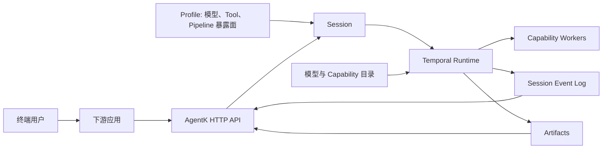

# agent-k

AgentK 是面向下游 AI 应用的分布式、持久化 Agent Runtime。它基于 Temporal 统一承载
Agent Loop 与 Pipeline，负责长期任务的推进、恢复、状态记录和产物管理。

AgentK 是中台，不是终端应用：

- 下游应用通过 HTTP API 创建 Session、提交任务并消费结果；
- 终端用户身份、业务权限、文件上传以及终端用户到 Session 的映射由下游应用管理；
- AgentK 的 Artifact 只表示工具执行产生的结果。

核心约定：

- **Profile 随 Session 固化**：创建 Session 时必须提交完整 Profile，明确该 Session
  可以使用的模型、Tool 和 Pipeline；服务端不提供缺省 Profile。
- **Loop 与 Pipeline 共用运行底座**：模型可以动态选择 Tool，代码也可以用 Temporal
  Workflow 定义确定流程，两者共享 Session、Capability、事件和 Artifact。
- **执行与事实分层**：Temporal History 保存执行现场，Session Event Log 保存对外事实；
  进程或连接中断不会丢失已经提交的任务。
- **实时与持久通道分工**：SSE 回放并跟随当前 Execution 的实时缓冲，Event Log 返回
  带稳定 EventID 的完整历史与最终结果。

## 运行模型



下游应用负责用户体验和业务领域；AgentK 负责让任务可靠运行，并用稳定的 API、事件和
产物引用返回执行结果。

## 本地启动

需要 Go 1.26+、Kess Agent 和一个 OpenAI-compatible chat 模型凭证。

在仓库根目录复制模型目录示例。保留一个 chat 模型条目并设置它引用的 API Key
环境变量：

```bash
cp models.example.yaml models.yaml
export DS_API_KEY='<your-api-key>'
```

使用单进程、内存存储和固定开发身份启动：

```bash
export AGENTK_MODE=standalone
export AGENTK_STORE=mem
export AGENTK_AUTH=off

export AGENTK_MODELS=./models.yaml
export AGENTK_ARTIFACT_STORE=local

go run ./cmd/agentk-api
```

服务缺省监听 `:8080`。确认启动成功：

```bash
curl -fsS http://localhost:8080/healthz
```

## 部署形态

`agentk-api` 在 standalone 模式下附带 Worker，适合本地开发；deployed 模式下只提供
HTTP/SSE，由单独的 `agentk-worker` 消费 Temporal 任务：

```bash
# API 进程
export AGENTK_MODE=deployed
export AGENTK_STORE=kdb       # 或 mysql
export AGENTK_AUTH=apikey
go run ./cmd/agentk-api

# 独立 Worker 进程；不读取 MODE / AUTH / LISTEN
export AGENTK_STORE=kdb       # 与 API 指向同一持久化 Store
go run ./cmd/agentk-worker
```

两个进程必须指向相同的 Temporal、Kedis、持久化 Store、模型目录和 BlobStore。
Worker 会直接读取 Session/Event Log，并由 Activity 追加执行事件；Workflow 本身不做
数据库或网络 I/O。Worker 启动时只校验数据库 schema，不执行 migration。

## 启动配置

三条运行轴全部必填、无缺省：

- `AGENTK_MODE=standalone|deployed`：只属于 API；`standalone` 使用进程内共享状态并
  附带 Worker，`deployed` 使用 Kedis 且不启动 Worker。
- `AGENTK_STORE=mem|mysql|kdb`：选择 Session Event Log 与身份数据的存储后端。
- `AGENTK_AUTH=apikey|off`：`apikey` 使用 Service Principal API Key；
  `off` 注入固定开发身份。

组合约束：

- `deployed` 不能配 `mem` 或 local Artifact Store；
- `apikey` 不能配 `mem`；
- `off` 可以配持久化存储，但所有请求仍使用固定开发身份，数据库中的 API Key 会被忽略。

Temporal 通过 KESS 动态发现，固定使用 `agentk` Namespace 和 Task Queue，无需配置
address 或 namespace。其余启动入口：

- `AGENTK_MODELS` 指向本地模型目录；线上可改用 `AGENTK_MODELS_KCONF_KEY`；
- `AGENTK_ARTIFACT_STORE` 缺省为 `blob`；只有 standalone 本地开发可以显式设为 `local`；
- `AGENTK_LISTEN` 可选，缺省为 `:8080`。

各存储后端、Kedis、BlobStore 和模型凭证的具体配置由对应组件维护，不在 README
复制完整环境变量清单。

## 继续阅读

- [AgentK 文档](https://git.corp.kuaishou.com/kling-agent/agent-sys/agentk-docs)：
  架构、下游接入和独立 Worker 开发。
- [模型目录示例](models.example.yaml)：模型条目及凭证引用方式。
- [OpenAPI 契约](internal/api/openapi.yaml)：HTTP API 的字段与错误契约；服务启动后也可访问
  `/docs`。
